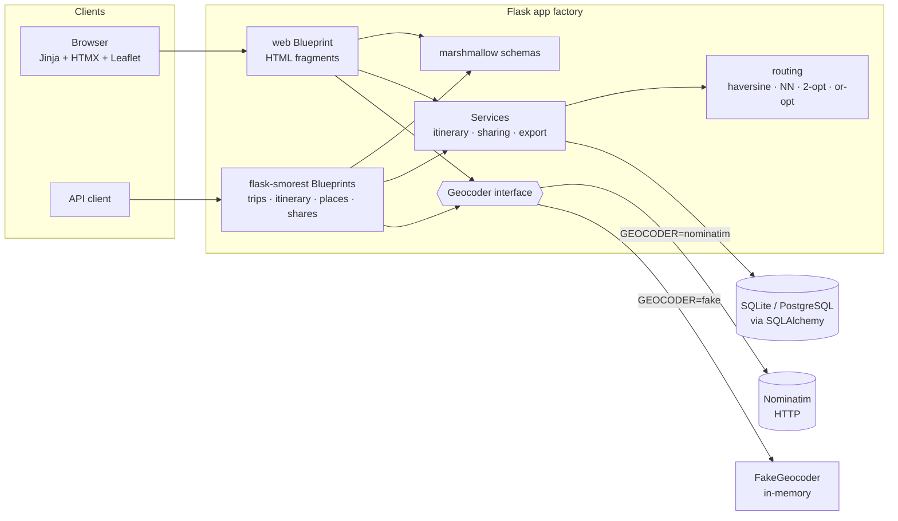

# trip-planner-flask

**Plan trips day by day: search OpenStreetMap places, drop them onto days, let the planner find a shorter route, and share a read-only link.**

[](https://github.com/alexgeorghiou/trip-planner-flask/actions/workflows/ci.yml)
[](LICENSE)


A Flask application built the classic way: an app factory, Blueprints, Flask-SQLAlchemy models,
marshmallow schemas and a flask-smorest JSON API with generated OpenAPI docs, plus a
server-rendered Jinja UI that uses HTMX for partial page updates instead of a JavaScript framework.

## Features

- **Day-by-day itineraries.** A trip gets one day per calendar date. Each day holds an ordered list
  of stops with optional arrival time, duration and notes.
- **Safe date changes.** You can extend or shorten a trip, or shift the whole trip to new dates.
  Shortening is refused (HTTP 409) if it would delete a day that still has stops.
- **Place search** through [OpenStreetMap Nominatim](https://nominatim.org/), behind a `Geocoder`
  interface. The HTTP client sends a proper `User-Agent`, waits at least one second between
  requests and caches results, as the
  [Nominatim usage policy](https://operations.osmfoundation.org/policies/nominatim/) asks.
  An offline `FakeGeocoder` is used in tests and demos.
- **Route ordering per day.** Haversine distances, a nearest-neighbour first pass, then 2-opt and
  or-opt passes to shorten it. The first stop (your hotel) stays fixed, and you can also fix the
  last stop. You can preview the result before saving it.
- **Shared trips.** Share links use unguessable tokens. You can label them, give them an expiry
  date and revoke them. A link opens a read-only page and a read-only JSON endpoint, with private
  notes left out.
- **HTMX UI.** Search as you type, add stops, move them up or down, remove them and run route
  optimisation without full page reloads. A Leaflet map shows each day's route in its own colour.
- **OpenAPI 3** spec at `/api/openapi.json` and Swagger UI at `/api/docs`.
- **GeoJSON export** of stops and day routes (`/api/trips/{id}/geojson`).

## Architecture



Request handlers stay thin. They validate input with marshmallow, call a service function and
render JSON or an HTML fragment. All writes go through `services/`, which keeps two rules true:
a trip has exactly one day per date in its range, and each day's stop positions run `0..n-1`
with no gaps. `routing/` is plain Python with no Flask or database imports, so it can be tested
on its own.

## Quickstart

```bash
python -m venv .venv
source .venv/bin/activate          # Windows: .venv\Scripts\activate
pip install -e ".[dev]"

# Offline demo data and an offline geocoder:
export GEOCODER=fake               # PowerShell: $env:GEOCODER = "fake"
flask --app trip_planner.wsgi seed-demo
flask --app trip_planner.wsgi run --debug
```

Open <http://127.0.0.1:5000>. The API docs are at <http://127.0.0.1:5000/api/docs>.

To search real places, leave out `GEOCODER=fake` and set a User-Agent that identifies your
deployment:

```bash
export NOMINATIM_USER_AGENT="my-trip-planner/1.0 (you@example.com)"
```

### Docker

```bash
docker compose up --build          # Flask + gunicorn on :8000, PostgreSQL 16
```

The image runs `flask init-db` once in its entrypoint and then starts gunicorn as a non-root user.

### Tests and lint

```bash
pytest -q
ruff check . && ruff format --check .
# or, on Linux/macOS: make install lint test
```

The tests make no network calls. The Nominatim client is tested against an `httpx.MockTransport`,
the app uses `FakeGeocoder`, and an autouse fixture makes any socket connection fail.

## API at a glance

| Method | Path | Purpose |
| --- | --- | --- |
| `GET/POST` | `/api/trips` | List trips (paginated, `?q=` filter) or create one |
| `GET/PATCH/DELETE` | `/api/trips/{id}` | Full itinerary, update details or dates, delete |
| `POST` | `/api/trips/{id}/shift` | Move the whole trip to a new start date |
| `GET` | `/api/trips/{id}/geojson` | GeoJSON FeatureCollection |
| `GET/PATCH` | `/api/days/{id}` | A day with its stops and distance |
| `POST` | `/api/days/{id}/stops` | Add a stop (optionally at a `position`) |
| `PUT` | `/api/days/{id}/stops/order` | Set the order explicitly |
| `POST` | `/api/days/{id}/optimize?keep_last=&apply=` | Reorder stops to shorten the route |
| `PATCH/DELETE` | `/api/stops/{id}` | Edit or remove a stop |
| `POST` | `/api/stops/{id}/move` | Move a stop to another day or position |
| `GET` | `/api/places/search?q=&limit=&country=` | Geocoder search |
| `GET/POST` | `/api/trips/{id}/shares` | List or create share links |
| `DELETE` | `/api/shares/{id}` | Revoke a link |
| `GET` | `/api/shared/{token}` | Public read-only itinerary |

```bash
curl -s -X POST localhost:5000/api/trips -H 'content-type: application/json' \
  -d '{"title":"Rome","start_date":"2026-04-10","end_date":"2026-04-12"}'
curl -s -X POST 'localhost:5000/api/days/1/optimize?apply=false'
```

## Configuration

| Variable | Default | Notes |
| --- | --- | --- |
| `FLASK_CONFIG` | `development` | `development`, `testing` or `production` |
| `DATABASE_URL` | `sqlite:///trip_planner.sqlite3` | Any SQLAlchemy URL; compose uses `postgresql+psycopg://` |
| `SECRET_KEY` | dev value | Set it in production |
| `GEOCODER` | `nominatim` | `nominatim` or `fake` |
| `NOMINATIM_URL` | public instance | Point at a self-hosted Nominatim for heavy use |
| `NOMINATIM_USER_AGENT` | `trip-planner-flask/0.1 (self-hosted)` | Required by the usage policy; include a contact |
| `NOMINATIM_EMAIL` | unset | Sent as the `email` parameter |
| `GEOCODER_CACHE_SIZE` | `256` | Size of the LRU cache for search results |
| `AUTO_CREATE_TABLES` | `1` | The container sets `0` and runs `flask init-db` instead |

## Project structure

```
src/trip_planner/
├── app.py              # create_app(): config, extensions, blueprints, error handlers
├── config.py           # Development / Testing / Production settings
├── extensions.py       # SQLAlchemy, geocoder accessor, SQLite FK pragma
├── models.py           # Trip, Day, Stop, ShareLink
├── schemas.py          # marshmallow request/response schemas
├── errors.py           # DomainError / ConflictError -> 422 / 409
├── api/                # flask-smorest Blueprints (OpenAPI)
├── web/                # Jinja + HTMX views
├── services/           # itinerary, sharing, GeoJSON export
├── routing/            # haversine, nearest-neighbour, 2-opt, or-opt (pure Python)
├── geocoding/          # Geocoder ABC, Nominatim client, LRU cache, fake
├── templates/          # pages and _partials swapped by HTMX
└── static/             # CSS and a small JS file for the map and HTMX error swaps
tests/                  # pytest: unit, service, API and HTML tests
```

## Design decisions and trade-offs

- **Heuristic routing instead of an exact solver.** A day usually has 3 to 15 stops. The
  nearest-neighbour pass followed by 2-opt and or-opt finishes in milliseconds. The tests compare
  it with brute force on random 7-stop days and require it to stay within 5% of the optimum. 2-opt
  alone sometimes missed that target, and adding or-opt fixed those cases. When the start stop is
  not fixed, the optimiser tries every stop as the start, up to 30 stops.
- **Straight-line distances.** Haversine distance is enough to decide a visiting order and needs
  no routing service. Walking or driving times would need OSRM or Valhalla, which is on the
  roadmap.
- **Open paths with fixed endpoints.** People rarely return to their first stop of the day, so
  the optimiser builds an open path. The first stop (and optionally the last) stays where it is.
- **The geocoder is an interface.** Handlers depend on `Geocoder`, never on `httpx`. Production
  code wraps the Nominatim client in an LRU cache, and the client handles rate limiting itself.
  Tests inject a fake through `create_app(geocoder=...)` or the `GEOCODER` setting.
- **Share links are capability URLs.** Tokens come from `secrets.token_urlsafe(24)`, giving 192
  bits of randomness. Shared pages send `noindex` and `no-referrer`. The read-only schema leaves
  out notes and internal IDs. Revoking a link keeps the row, so the history stays visible.
- **HTMX instead of a SPA.** Each action returns the HTML fragment for the day that changed, plus
  an `HX-Trigger` event that tells the map to reload. Responses with status 409 or 422 are still
  swapped in, so error messages appear next to the form.
- **No authentication.** This is a single-user planner meant to run locally or on a private
  deployment, and the web forms have no CSRF protection. Adding user accounts (Flask-Login plus
  CSRF) is the first roadmap item.
- **`db.create_all()` instead of migrations** keeps the project small. Alembic would be the next
  step once the schema changes after release.

## Roadmap

- [ ] User accounts with per-user trips and CSRF-protected forms
- [ ] Drag-and-drop reordering (the `PUT /stops/order` endpoint already exists)
- [ ] Travel times from OSRM or Valhalla, and opening-hours constraints when ordering stops
- [ ] Alembic migrations
- [ ] iCal export of each day's schedule

## License

[MIT](LICENSE) © 2026 Alex Georghiou. Map data © OpenStreetMap contributors (ODbL).
